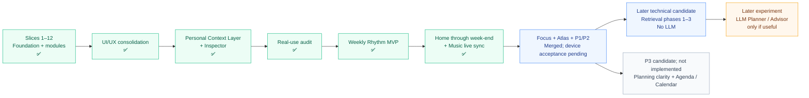

# Product Roadmap

> Current status (2026-10-30): Focus + Atlas #102 and polish #103/#105 are merged into `main`. Trial/merge-pending passages below describe the earlier trial and are historical; use current `main` and the delivery rules in `AGENTS.md` for new work. The read-only assistant connection is documented in [assistant-connection.md](assistant-connection.md).

This roadmap tracks delivered slices and the current product direction. Sequence matters more than fixed dates, and a structurally obvious feature should not outrank a workflow that is actually useful.

The project has now moved out of its module-building phase. The default question is no longer **“what new space should we add?”** but **“how can the information already in Personal Control Center work together?”** New standalone domains should require a clear recurring need.

The broad UI/UX consolidation work is complete enough to return to a usage-led approach: future interface changes should respond to concrete friction rather than modernisation for its own sake. The **Personal Context Layer and Context Inspector are now implemented** as the cross-space foundation.

The real-use audit is documented, **Weekly Rhythm and the Personal Context Layer are implemented**, and Home already displays dated work through the current Saturday–Friday week (PR #83). The Spotify Music space is also deployed and its automatic collection and genre-enrichment worker passed a live Pi smoke test on 20 October 2026.

**UI status, 30 October 2026:** Focus + Atlas (#102), P1 polish (#103) and P2 polish (#105) are merged into main. P1 restores grouping and phone navigation; P2 improves source links, planning/collection interactions and secondary layouts. See [`ui-polish-2026.md`](ui-polish-2026.md) for delivered behavior and validation limits. Merge status does not establish deployment or visual acceptance.

**Next UI candidate: P3, not implemented.** [`ui-polish-p3.md`](ui-polish-p3.md) separates remaining Home/Week and Calendar decisions from smaller state/coverage/accessibility improvements. Start with inspection and acceptance of the current merged UI; use observed friction to select the next implementation slice. The plan is not evidence that every earlier audit item has been resolved or that a new redesign is approved.

The retrieval and AI sections below remain broader candidates, not instructions to expand UI work. The capture-centred graph Home remains deferred. Continue observing Rhythm and Agenda during ordinary use; choose subsequent work from owner feedback. AI remains exploratory, not a committed next slice.

See [`usage-audit-2026-10.md`](usage-audit-2026-10.md) and [`weekly-rhythm.md`](weekly-rhythm.md).

## Progress at a glance

## Delivered foundation

### Slice 1 — Phone-first foundation

**Status: complete in PR #7.**

Delivered the initial shell, Capture, Inbox, Projects, Thoughts, Review, All Spaces, prototype persistence, early PWA support, and Docker-ready runtime.

### Slice 2 — Actionable projects

**Status: complete in PR #10, with later action refinements.**

Projects support action history, Waiting, overdue attention, completion notes, Accomplishments, Archive, multiple open actions, optional dates, optional Details, rescheduling history, and explicit project completion.

PR #62 also surfaces project actions due today on Home alongside Tasks.

### Slice 3 — Durable deployment

**Status: complete in PR #13, with later hardening.**

The application runs on a Raspberry Pi with PostgreSQL canonical state, invite-only isolated accounts, Tailscale Funnel, local backups, encrypted off-site R2/restic backups, restore tooling, and production validation.

### Slices 4–6 — Tasks, Weekly Review, Calendar, and offline Capture

**Status: complete.**

Delivered standalone Tasks, fixed Saturday-to-Friday Weekly Review, History, reminders, review photos, one-way Google Calendar projection for dated Tasks/project actions, and Capture-only offline recovery through the PWA/service worker.

### Workflow extensions — Projects and Notes

**Status: complete.**

Notes provide autosaving editable reference text, safe Markdown, compact cards, ordering, and separation from Thoughts. Projects support multiple open actions and lightweight action Details without becoming a subtask system.

### Slice 7 — Book Library

**Status: complete in PR #32, with later refinements.**

Books support ownership, reading state, Wishlist, Up next, private covers, dates, 0–10 ratings, reflections, ordering, and review context. The normal bookshelf remains owned-first rather than mixing Wishlist records into everyday browsing.

### Slice 8 — Interface simplification and themes

**Status: complete.**

The app uses compact phone-first navigation, configurable mobile pins, All Spaces, shared semantic styles, and optional game-inspired themes without changing workflow semantics.

### Slice 9 — Personal Expenses

**Status: complete.**

Expenses support fast manual entry, fixed 50/30/20 reference targets, rolling Fun Fund, editable history, and filtered Insights without imposing a weekly bank-reconciliation ritual.

### Slice 10 — Encrypted Password Keychain

**Status: complete in PRs #55, #56, and #58.**

The Keychain is a client-encrypted vault with its own security boundary, recovery flow, isolated tables/APIs, ciphertext-only backup/export behavior, and explicit browser-delivered-code limitations.

Keychain is permanently excluded from every AI/context path.

### Slice 11 — Food v1

**Status: complete in PR #60.**

Food shipped as a lightweight Recipe Book with recipes, ingredients, steps, notes, photos, tags, ratings, make-again state, and Copy ingredients. Meal planning, nutrition, freezer inventory, and other routine features remain deferred until real use justifies them.

### Slice 12 — Library: Books, Movies, and Series

**Status: complete in PR #64.**

Library is now one umbrella space with first-level **Books | Movies | Series** shelves rather than a separate top-level Media destination.

Movies support independent status/wishlist browsing, rating, thoughts, one optional Watched on date, and private posters.

Series support independent status/wishlist browsing, rating, thoughts, optional start/finish dates, private posters, and lightweight current season/episode resume position. Series opens on Watching by default.

Historical completeness is not required. New Media data can accumulate naturally instead of becoming a backfilling task.

See [`media-library.md`](media-library.md).

## UI/UX consolidation — delivered, now usage-led

**Status: earlier consolidation delivered; selected Focus + Atlas implementation is now in personal trial, not merged.**

Navigation, Home/Today, density, visual hierarchy, and shared interface rules have already received the main consolidation pass recorded in [`ux-refresh-2026.md`](ux-refresh-2026.md).

The latest revised Focus phone and Atlas desktop Figma direction is implemented across the app in draft PR #102. Retain existing capabilities when the frames omit them, all ten themes and canonical data semantics. The next changes should address trial friction on the same branch. Agenda keeps its existing capability inside the selected layout; the wider Calendar ownership question remains separate.

## Personal Context Layer — implemented

**Status: implemented as deterministic, read-only cross-space infrastructure.**

`src/domain/personal-context.ts` now composes bounded representations from explicitly selected domains:

- Projects;
- Tasks;
- Weekly Reviews;
- Thoughts;
- Notes;
- Library;
- Food;
- Expenses.

The layer uses canonical PCC state, preserves stable record IDs where useful, includes current/open state plus bounded recent history, truncates long text predictably, and requires explicit domain selection.

It does **not** provide a generic database query interface. Calendar and Markets are not context domains yet because there is no concrete consumer that needs them.

Keychain is structurally excluded: it is not part of the domain type, parser, builder, or context endpoint.

### Context Inspector — implemented

The authenticated **Context Inspector** at `/spaces/context` exposes the exact structured representation produced by the layer.

It shows:

- selected domains and purpose;
- the applied limits;
- the exact generated context;
- character count and an approximate token count.

This is a development/privacy-audit surface rather than a normal daily workflow. It allows the context boundary to be inspected before any LLM provider is introduced.

## Weekly Rhythm — implemented, pending real-use test

The real-use audit led to the Weekly Rhythm MVP implemented in merged PR #79. Real-use validation should continue on the deployed product, especially whether weekly focus and the Saturday–Friday horizon reduce artificial due dates.

The strongest signal is a gap between work with a genuinely meaningful date and work that should remain visible during the week but can happen flexibly. Arbitrary dates can become hiding places when items are repeatedly rescheduled.

Weekly Rhythm should solve that gap without duplicating Tasks, Projects, Review, or Google Calendar.

The defined model includes:

- **Fixed commitments** — read-only time-specific events that constrain the week;
- **Dated work** — existing Tasks and Project Actions with meaningful dates;
- **Weekly Focus** — references to existing Tasks/Project Actions chosen for the current week without inventing a specific date;
- **Rhythm intentions** — flexible weekly targets such as doing something 2–4 times during the week;
- **Completion events** — lightweight history rather than a mutable streak counter.

Weekly Rhythm uses the established **Saturday-to-Friday** period so Saturday Review can naturally close the previous week and open the next planning horizon.

The initial experience should be a phone-first **This Week** view with simple progress, not a generic routine database. No XP, streak flames, rigid daily schedules, or automatic guilt-oriented carry-forward are planned.

See [`weekly-rhythm.md`](weekly-rhythm.md) for the implementation-ready product specification and [`usage-audit-2026-10.md`](usage-audit-2026-10.md) for the evidence behind it.

The Weekly Rhythm domain is already exposed through Personal Context, and
Weekly Review already includes Rhythm progress/focus. Home now shows dated work
through Friday of the current weekly period (PR #83). The next product decision
is whether additional **native Calendar context** is useful on Home or in a
simpler Upcoming view; issue #72 owns that assessment.

## Next technical candidate — deterministic retrieval (Phases 1–3)

The existing Context Inspector exposes bounded current-state snapshots, not an
on-demand search across all eligible retained history. The proposed next
technical slice, detailed in [`context-retrieval-memory.md`](context-retrieval-memory.md),
would deliver:

1. **Retrieval documents** from the complete eligible PCC archive with domain,
   canonical source IDs, dates and metadata;
2. **Authenticated lexical/exact retrieval** with rankings, reasons and source
   provenance, including old Reviews and Library entries outside the default
   bounded context;
3. **Question-driven Resolved Context Inspector** showing selected current
   state, retrieved records, why they were included, and the final budgeted
   context bundle.

This is intentionally **not** an LLM chat feature. It establishes and tests
retrieval quality first; a provider-neutral model-based Context Planner is a
later phase if the deterministic resolver proves useful. Keychain stays
excluded. The decision to start this slice should be made after confirming
current real-use priorities.

## AI direction — experiment, not committed product slice

See [`personal-advisor.md`](personal-advisor.md).

The earlier roadmap promoted a read-only Personal Advisor directly after Media. That is no longer the current commitment.

The stronger reason to explore AI is twofold:

1. test whether coherent PCC context enables genuinely better conversations or interactions than ordinary deterministic views;
2. use PCC as a practical environment for learning how API authentication, billing, model selection, reasoning effort, token usage, memory, tools, safety, and provider choice work in a real personalised system.

### Experimental LLM sandbox

With the Personal Context Layer in place, an internal LLM sandbox may be added later if the usage audit and deterministic integrations still leave a clear conversational need.

A useful experiment would expose:

- free-form and multi-turn conversation;
- selected context domains;
- model and reasoning/effort configuration;
- input/output token usage;
- approximate request cost;
- latency and errors;
- the exact context sent to the provider.

Calls should initially happen only when explicitly requested by the user. There is no reason to pay for periodic background inference just to make PCC appear intelligent.

### What is worth testing

The experiment should not be reduced to recommendation buttons.

Potentially meaningful uses include:

- discussing a book after finishing it;
- returning months later to compare a new reading experience with an older book and previous reflection;
- discussing a Weekly Review conclusion from another perspective;
- talking through a work/study/life decision while relevant Projects and recent reflections are available;
- asking a broad question without first manually reconstructing the relevant PCC context.

The model may bring broader public/general knowledge into the conversation while PCC contributes private structured context.

This is closer to the long-term idea of a conversational personal counterpart than a recommendation engine, but it must prove value through real use.

### Retrieval and memory

The current bounded Personal Context is not the final retrieval system.

Future Advisor/context work should keep three boundaries distinct:

- the **canonical archive** can retain and expose all eligible historical records for search;
- the **retrieval layer** selects relevant old records from that archive for the current question;
- **memory** stores only durable learned conclusions or episodic summaries that are worth carrying forward.

The twelve-record/90-day defaults are therefore active-context bounds, not the point at which old Reviews or Library records become inaccessible.

The selected next context/Advisor engineering slice is a **Context Retrieval Foundation**:

1. project eligible records into searchable retrieval documents with stable provenance;
2. search the whole eligible archive with deterministic exact/lexical ranking;
3. add a question-driven Resolved Context Inspector that shows candidates, scores, current-state additions, and the final budgeted context;
4. only then add a structured model-based Context Planner;
5. add embeddings/hybrid semantic retrieval only where lexical search demonstrably misses useful material;
6. defer episodic summaries and stable memory until retrieval itself is useful.

See [`context-retrieval-memory.md`](context-retrieval-memory.md).

### Model independence

Durable PCC context, retrieval documents/indexes, episodic summaries, and stable memory should be owned by PCC rather than one model generation. A later model should be able to consume the same personal history even if the provider or model changes.

### Promotion gate

Do not promote the sandbox into a polished Advisor merely because the API works.

A permanent AI product should show repeated value beyond:

- what Home/Review/Library can already show deterministically;
- what a normal ChatGPT conversation can provide with manually supplied context;
- occasional one-off recommendations.

Good evidence would include repeated use where stored PCC history materially improves the conversation, meaningful continuity from memory, cross-domain reasoning that is inconvenient to assemble manually, or confirmed-action workflows that remove real friction.

If those signals do not appear, the experiment can remain internal, be removed, or evolve into a PCC-to-external-assistant connector.

### Read/write boundary

Initial experiments remain read-only with respect to canonical PCC data.

Future model-assisted writes may be useful, for example:

- rescheduling a Task/project action from natural language;
- saving a generated shopping list as a Note;
- adding a proposed item to a wishlist.

If explored, the model should propose a specific structured mutation, PCC should show it, and the user must explicitly confirm it through the normal deterministic mutation path.

Do not give an LLM unrestricted database-write access or allow ordinary conversation to silently create Thoughts, Notes, Tasks, or other records.

### Proactivity

A future Jarvis-like direction may include proactive observations, but deterministic software should detect simple facts first.

For example, PCC can identify overdue actions, repeated reschedules, unfinished Reviews, or projects with no open actions without spending model tokens. AI should be invoked only if interpretation adds value.

Proactivity must prove that it is helpful rather than noisy before becoming recurring behavior.

### External-assistant option

PCC may eventually expose the same carefully scoped context/tools to an external conversational product such as ChatGPT through an appropriate connector/tool protocol.

That route may be preferable if ChatGPT remains a better conversational environment while PCC remains the canonical personal-data source.

The architecture should therefore avoid tying the Personal Context Layer specifically to one PCC chat page.

## Integration principle — shared context before hard coupling

Do not create database relationships merely because two spaces could theoretically be connected.

Examples:

- Food can expose saved recipes, ratings, make-again state, and cooking notes without directly owning supermarket transactions.
- Expenses can expose bounded spending context without linking every purchase to another domain.
- Library can expose ratings, reflections, Wishlist/current state, and sparse history without becoming an AI recommendation engine itself.
- Projects, Tasks, dates, and Weekly Review can contribute to a common workload view without changing canonical ownership.
- Thoughts can be context without silently becoming obligations.

Shared context should make later integrations possible without forcing them.

## Weekly Rhythm and connected planning

**Status: implemented in PR #79; pending combined real-use testing.**

Weekly Rhythm now has an implementation-ready design covering weekly focus, recurring intentions, progress events, week boundaries, Home/Agenda integration, Review integration, and Context Layer follow-up.

See [`weekly-rhythm.md`](weekly-rhythm.md).

## Targeted cross-space integrations

Direct cross-space behavior should be added only when a real workflow benefits from it.

Possible later examples:

- Food → planned meal/prep context → Weekly Rhythm;
- Library → current reading/watching context → conversation or planning;
- Tasks/project actions → Home, Calendar, Weekly Rhythm, or confirmed natural-language control;
- Weekly Review → context for later reflection or pattern discussions;
- Thoughts → context or explicit user-approved conversion suggestions;
- Expenses → bounded financial context while otherwise remaining largely standalone.

These are examples, not commitments.

## Other future candidates and follow-ups

### Today/Home horizon

**Delivered (PR #83).** Home's compact near-term list now includes overdue
work, due-today items and upcoming dated Tasks/Project Actions through Friday
of the current Saturday–Friday week. It does not pressure flexible work into
invented dates. Calendar events/commitments on Home are a separate product
decision under issue #72.

### Food follow-ups

Use the Recipe Book first. Revisit prepared portions/freezer inventory, weekly meal expectations, Prep Sunday, nutrition, or grocery workflows only after real meal-prep usage shows which information is worth maintaining.

### Routines/Habits

Consider recurring responsibilities as possible Weekly Rhythm inputs before automatically creating another standalone space. Avoid generic streak mechanics without a real planning need.

### Events/Appointments

A future time-specific commitment model could justify start/end times, locations, preparation context, and perhaps a clearer reason to revisit inbound Calendar synchronization.

### Trips

Prefer integration with existing dates, Tasks, Expenses, and context before building a large travel-management module.

### Fitness

Prefer imported activity/trend summaries over a manual workout logger. Recurring training structure may be useful before a dedicated space is justified.

### Library follow-ups

**Comic / sequential-work support is implemented** inside Books rather than as a separate top-level space.

The delivered lightweight model includes:

- optional Comic/sequential toggle;
- Physical / Digital / Both / Unspecified format;
- current issue / resume position;
- tolerant free-form issues-read ranges/labels;
- Type/Format filtering;
- comic progress in Personal Context.

It intentionally does not require issue-by-issue catalogue completeness, variant-cover cataloguing, or publication metadata.

Cover-assisted book identification remains a deferred reliability/performance follow-up in open issue #77. Metadata lookup beyond that experiment, highlights, streaming availability, and automatic catalog imports should still wait for observed need.

See [`book-library.md`](book-library.md).

### Weekly Review Web Push

The real-device observation in issue #21 confirmed that browser-side scheduling alone does not deliver while the PWA is closed. The narrow server-driven Web Push follow-up shipped in PR #75 (with proxy access corrected in PR #78): an hourly worker checks for a due Weekly Review and sends at most one reminder per local day from Saturday through Friday while it remains unsubmitted.

This does not open a generic notifications roadmap. Broader task/project notifications remain out of scope unless real usage creates a specific need.

### Calendar role

Issue #72 now owns the Agenda/Google Calendar product decision, including whether a dedicated Agenda survives, becomes Upcoming, or yields to selective Calendar context on Home/Today. The older optional two-way-sync issue #26 was closed as superseded.

### Music listening archive

**Status: delivered and deployed; scheduled-worker smoke test passed on Raspberry Pi (20 October 2026).**

The Music space preserves timestamped Spotify listening history as a private personal time capsule; it is not a new streaming player.

- **Foundation (PR #85):** user-scoped historical import, OAuth, encrypted refresh credentials, recent-play ingestion, and a dedicated worker.
- **Insights (issue #86; PR #90 with later refinements):** month/year/all-time listening summaries, artist rankings, rediscovery, genre coverage, and time-zone-aware views.
- **Enrichment and archive (issue #87; restored in PR #92):** bounded Last.fm genre caching and opt-in append-only playlist updates once songs qualify.
- **Production fixes (PRs #95–96):** let the authenticated worker pass the session proxy, isolate polling stages, log outcomes, and skip unrecognized Last.fm songs without stopping the tagging batch.

A live automatic poll after restarting the worker imported new plays and processed
12 genre candidates with **zero stage failures**. This validates the startup
path; consecutive hourly invocations were not separately observed at the time
of documentation. Playlist reconciliation returned zero additions, so an
actual qualifying-track append remains unverified. The user opted to keep the
12-tracks-per-hour backfill instead of prioritizing bulk enrichment.

**No additional Music development is selected now.** Keep the raw Spotify
export out of Git, minimize retained metadata, and keep the rest of PCC useful
if Spotify is disconnected. Genres are not personal mood inferences.

See [`spotify-music.md`](spotify-music.md).

## Product rules that continue to constrain future work

- Phone usability comes before desktop decoration.
- PCC remains useful without integrations, notifications, or AI.
- External services do not silently become canonical.
- Offline claims remain narrower than the actual supported workflow.
- New modules should solve observed recurring needs.
- Shared context should come before hard coupling.
- Domain-specific context providers are preferred over generic database access.
- Missing/sparse personal history must not be treated as negative evidence.
- AI is exploratory and advisory until proven otherwise.
- No polished Advisor is currently committed.
- Model calls should not be spent on facts deterministic code can compute.
- Any future model-assisted mutation must be explicit and user-confirmed.
- Keychain secrets are never part of AI/context paths.
- Features should be selected from observed friction or value, not because they are common in planning apps.

The current direction is: **keep real-use feedback on Weekly Rhythm, settle the Agenda/Calendar role only when necessary, and prefer deterministic full-history retrieval (Phases 1–3) as the next technical build before introducing an LLM.** Projects UX (#73) and cover recognition (#77) remain targeted, non-blocking follow-ups.
